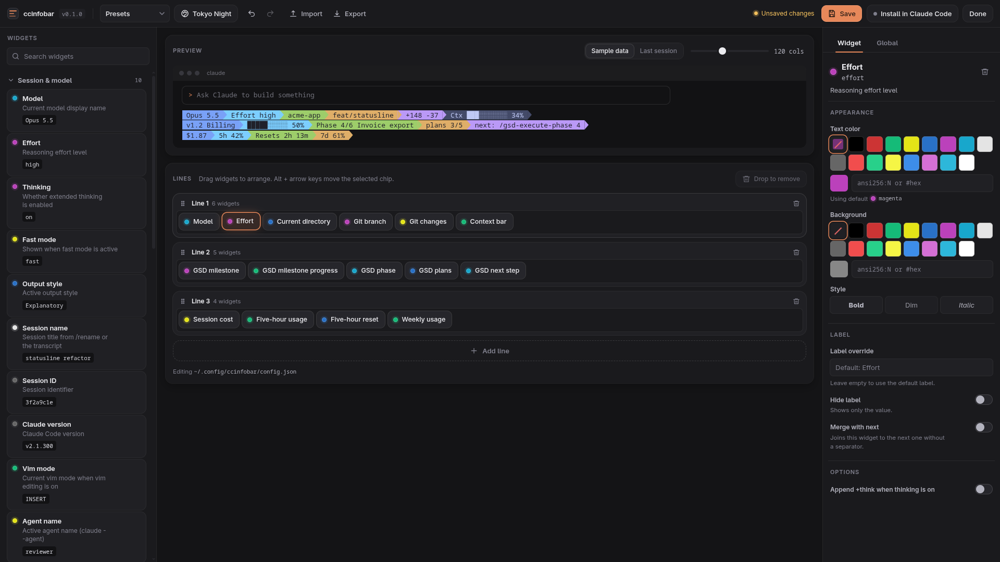

<div align="center">

# ccinfobar

**A customizable status line for Claude Code, with a drag-and-drop editor.**

[](CHANGELOG.md)
[](https://github.com/alpadalar/ccinfobar/actions/workflows/ci.yml)
[](package.json)
[](package.json)
[](LICENSE)



</div>

```
Opus 5.5 │ acme-app │ feat/statusline │ Ctx ███░░░░░░░ 34%
v1.2 Billing │ █████░░░░░ 50% │ Phase 4/6 Invoice export │ executing │ plans 3/5
next: /gsd-execute-phase 4 │ $1.87 │ 5h 42% │ Resets 2h 14m │ 7d 61%
```

## Contents

- [Why ccinfobar](#why-ccinfobar)
- [Quick start](#quick-start)
- [Editing your status line](#editing-your-status-line)
- [Widgets](#widgets)
- [Themes](#themes)
- [GSD integration](#gsd-integration)
- [Commands](#commands)
- [Configuration](#configuration)
- [Platform notes](#platform-notes)
- [Troubleshooting](#troubleshooting)
- [Contributing](#contributing)
- [Acknowledgements](#acknowledgements)

## Why ccinfobar

- **Drag-and-drop editor.** `ccinfobar edit` opens a local web editor with a live terminal preview. Drag widgets in from the palette, reorder them within or across lines, and style them in an inspector. It scales cleanly from 1080p to 4K.
- **24 themes, or your own.** Colored text, colored blocks, powerline arrows, rounded capsules or a bordered panel with a responsive grid, from classic to Nord, Dracula, Rosé Pine, Tokyo Night and Catppuccin. ASCII mode for terminals without a Nerd Font. Preview them all with `ccinfobar themes` and write your own in a few lines of JSON.
- **Terminal editor too.** `ccinfobar tui` does the same from the keyboard (or mouse) when you are on SSH or prefer to stay in the terminal.
- **First-class GSD support.** Milestone progress, the current phase, plan completion inside the phase, the next command to run, blockers, requirements and more, as separate widgets you can arrange freely. See [docs/GSD.md](docs/GSD.md).
- **83 widgets** covering model and session, context window, tokens and prompt cache, cost, 5-hour and weekly limits with pace tracking, git, workspace, system and custom commands.
- **Uses the current Claude Code payload.** Rate limits, prompt cache statistics, PR status and repository info come straight from the status line JSON, without extra API calls.
- **Fast and dependency-free.** Zero runtime dependencies, lazy data loading and an incremental transcript cache.
- **Cross-platform.** Linux, macOS and Windows, tested in CI on all three with Node 20, 22 and 24.

## Quick start

Requirements: [Claude Code](https://code.claude.com) and Node.js 20 or newer.

```sh
npm install -g https://github.com/alpadalar/ccinfobar/releases/latest/download/ccinfobar.tgz
ccinfobar install
```

> ccinfobar is not on the npm registry yet, so this installs the latest GitHub release. Once it is published, `npm install -g ccinfobar` will work too. Run the same command again to update.

`install` points the `statusLine` setting in `~/.claude/settings.json` at ccinfobar (backing up the file first) and writes a default config. `ccinfobar uninstall` puts your previous status line (for example ccstatusline) back. The next Claude Code prompt shows the new status line.

Then make it yours:

```sh
ccinfobar edit     # browser editor
ccinfobar tui      # terminal editor
```

<details>
<summary>Manual setup</summary>

Add this to `~/.claude/settings.json`:

```json
{
  "statusLine": {
    "type": "command",
    "command": "ccinfobar",
    "padding": 0
  }
}
```

Add `"refreshInterval": 10` to refresh the status line every 10 seconds even while Claude is idle, so clocks and countdowns stay current.

</details>

## Editing your status line

### Web editor

```sh
ccinfobar edit
```

| Area | What you can do |
| --- | --- |
| Palette (left) | Search and browse widgets by category, each with a description and sample output. Drag one into any line or click `+`. |
| Preview (top) | A terminal-style live preview. Switch between sample data and your last real session, adjust the width, and pick your terminal's colors (16 profiles such as Windows Terminal, macOS Terminal, Solarized, Dracula, or custom) so the preview matches what you will really see. When started from a terminal, `ccinfobar edit` detects its colors automatically. |
| Lines (center) | Drag chips to reorder them or move them between lines, drop them on the trash to remove, drag line handles to reorder lines. `Alt` + arrow keys move the selected chip. |
| Inspector (right) | Colors (16 named, 256 palette or hex), background, bold/dim/italic, label override, merge, and every widget option. The **Global** tab covers style, separators, glyphs, icons, color depth and width. |
| Theme gallery | Every theme rendered live with your own widgets. Apply with one click, filter by style, save your current look as a new theme. |
| Top bar | Presets, undo/redo, import/export JSON, save (`Ctrl+S`), and one-click install into Claude Code. |

The editor runs only on `127.0.0.1` with a per-session token. Press **Done** or `Ctrl+C` to stop it.

### Terminal editor

```sh
ccinfobar tui
```

| Key | Action |
| --- | --- |
| `←` `→` / `↑` `↓` | Select widget / line |
| `Shift` + arrows (or `<` `>` `{` `}`) | Move the widget within or across lines |
| `a` | Add a widget (type to filter) |
| `Enter` / `e` | Edit properties |
| `d` | Remove widget |
| `n` / `D` / `K` `J` | New line / delete line / move line |
| `T` / `g` / `t` / `p` | Theme picker / global settings / presets / preview source |
| `u` / `U` | Undo / redo |
| `s` / `i` / `q` | Save / install / quit |
| `?` | Help |

Mouse works too: click to select, drag a chip to move it.

## Widgets

| Category | Widgets |
| --- | --- |
| Session & model | model, effort, thinking, fast mode, output style, session name and id, Claude Code version, vim mode, agent name, skills |
| Context window | used or remaining percent (optionally relative to the auto-compact limit), bar, length, window size, compaction count |
| Tokens & cache | input, output, cached, total, cache hit rate, cache expiry countdown, last cache miss cause, output speed |
| Cost & time | session cost, cost per hour, session and API duration, lines changed, message count |
| Usage limits | 5-hour and weekly usage (percent or 13 bar styles, with an even-pace marker), reset countdowns, weekly Sonnet/Opus usage, spend limit, usage pace |
| GSD | milestone, milestone progress, phase, status, plans, plan progress, next step, workstream, blockers, todos, requirements, last command, update notice, current task, summary |
| Git | branch, sha, changes, status, staged, unstaged, untracked, ahead/behind, conflicts, stash, in-progress operation, repo, worktree, pull request |
| Workspace | current directory (5 styles), project directory |
| System | clock, date, hostname, username, memory, load average, terminal width, platform |
| Custom | shell command output, clickable link, environment variable |
| Layout | text, separator, flex space |

Every widget hides itself when it has nothing to show. The full list with options and examples is in [docs/WIDGETS.md](docs/WIDGETS.md), or run `ccinfobar widgets`.

## Themes

```sh
ccinfobar themes          # preview every theme in your terminal
ccinfobar theme dracula   # switch
```

| Style | Themes |
| --- | --- |
| Colored text | `classic` (default), `minimal`, `mono`, `neon`, `pastel`, `amber`, `matrix` |
| Colored blocks | `blocks`, `slate`, `paper` |
| Powerline | `powerline`, `nord`, `dracula`, `gruvbox`, `tokyo-night`, `solarized`, `monochrome`, `dark`, `light`, `rose-pine` |
| Capsules | `catppuccin`, `bubblegum` |
| Panel (box with optional grid) | `panel` |


Any theme can be drawn in any style (`"style": "capsule"`), and per-widget colors always win. To make your own, run `ccinfobar theme new mine --from nord`, edit `~/.config/ccinfobar/themes/mine.json`, or use **Save as my theme** in the editor. Details: [docs/THEMES.md](docs/THEMES.md).

## GSD integration

If you use [GSD (Get Shit Done)](https://github.com/gsd-build/get-shit-done), ccinfobar reads your `.planning/` folder and shows where the project stands:

```
v1.2 Billing │ █████░░░░░ 50% │ Phase 4/6 Invoice export │ executing │ plans 3/5
next: /gsd-execute-phase 4 │ ⚠ 1 concern │ req 14/22
```

- Progress is computed from the plan and summary files on disk, using the same formula as GSD, so it stays correct even when `STATE.md` lags behind.
- Workstreams, decimal phases (`4.5`), nested plan folders and shipped milestones in `ROADMAP.md` are all handled.
- No processes are spawned; everything is read from files in a few milliseconds.

Start with `ccinfobar init gsd --force`, or drag widgets from the GSD category in the editor. Details: [docs/GSD.md](docs/GSD.md).

## Commands

| Command | Description |
| --- | --- |
| `ccinfobar` | Render the status line from the JSON on stdin (what Claude Code runs) |
| `ccinfobar edit` | Open the web editor (`--port <n>`, `--no-open`, `--no-detect`) |
| `ccinfobar tui` | Open the terminal editor |
| `ccinfobar install` | Set Claude Code's `statusLine` (`--command <cmd>`, `--refresh <seconds>`) |
| `ccinfobar uninstall` | Remove ccinfobar from Claude Code settings and restore the status line you had before |
| `ccinfobar themes` | Preview every theme (`--width <n>`) |
| `ccinfobar theme <id>` | Switch theme; `ccinfobar theme new <id> --from <theme>` creates your own |
| `ccinfobar init [preset]` | Write a preset: `default`, `minimal`, `gsd`, `powerline`, `full` (`--force` to overwrite) |
| `ccinfobar preview` | Print the status line with sample data (`--last` for your last session, `--width <n>`) |
| `ccinfobar widgets` | List all widgets |
| `ccinfobar doctor` | Check Node, config, Claude Code settings and terminal width detection |

All commands accept `--config <file>`.

## Configuration

The config lives in `~/.config/ccinfobar/config.json` (`%APPDATA%\ccinfobar\config.json` on Windows). The editors write it for you; to edit it by hand, see [docs/CONFIGURATION.md](docs/CONFIGURATION.md). It ships with a JSON schema, so editors such as VS Code autocomplete every field.

```json
{
  "lines": [
    [
      { "id": "m", "type": "model", "bold": true },
      { "id": "d", "type": "cwd", "options": { "style": "short" } },
      { "id": "f", "type": "flex" },
      { "id": "c", "type": "context-bar", "options": { "width": 12, "usable": true } }
    ]
  ],
  "theme": "tokyo-night"
}
```

## Platform notes

- **Fonts.** Powerline and capsule themes and the `nerd` icon set need a [Nerd Font](https://www.nerdfonts.com/). The default `text` icons work everywhere.
- **Colors.** The color depth is detected automatically and honors `NO_COLOR`, `FORCE_COLOR` and `COLORTERM`. Set `colorLevel` if your terminal disagrees.
- **Terminal width.** Used for `flex` spacing and truncation. ccinfobar probes the terminal Claude Code runs in on Linux and macOS. On Windows, set `maxWidth` to a fixed number if you use `flex`.
- **Windows.** Works in Windows Terminal, PowerShell and cmd. Prefer a global install; `npx` startup on Windows is slow.

## Troubleshooting

| Problem | Fix |
| --- | --- |
| Nothing shows up | Run `ccinfobar doctor`. Claude Code also hides the status line in untrusted folders and while dialogs are open. |
| Odd boxes instead of arrows or icons | Install a Nerd Font, or use a text or blocks theme and `text` icons. |
| GSD line is missing | You are outside a GSD project, or `.planning/STATE.md` / `ROADMAP.md` doesn't exist yet. |
| Usage limit widgets are empty | Claude Code only sends rate limits to Pro and Max subscribers, and they may be missing until the first response. |
| Preview in the editor doesn't match | Use **Last session** in the preview, after Claude Code has rendered the status line at least once. |

## Contributing

Issues and pull requests are welcome. See [CONTRIBUTING.md](CONTRIBUTING.md) and [docs/DEVELOPMENT.md](docs/DEVELOPMENT.md); adding a widget takes about 20 lines.

```sh
git clone https://github.com/alpadalar/ccinfobar.git && cd ccinfobar
npm install && npm run check && npm run build
```

## Acknowledgements

- [ccstatusline](https://github.com/sirmalloc/ccstatusline) by Matthew Breedlove pioneered the configurable widget-based status line and inspired much of this project.
- [claude-powerline](https://github.com/Owloops/claude-powerline), [claude-hud](https://github.com/jarrodwatts/claude-hud) and [claude-pace](https://github.com/Astro-Han/claude-pace) inspired the themes, the web editor idea and pace tracking.
- [GSD](https://github.com/gsd-build/get-shit-done) defines the planning format the GSD widgets read.

## License

[MIT](LICENSE)
